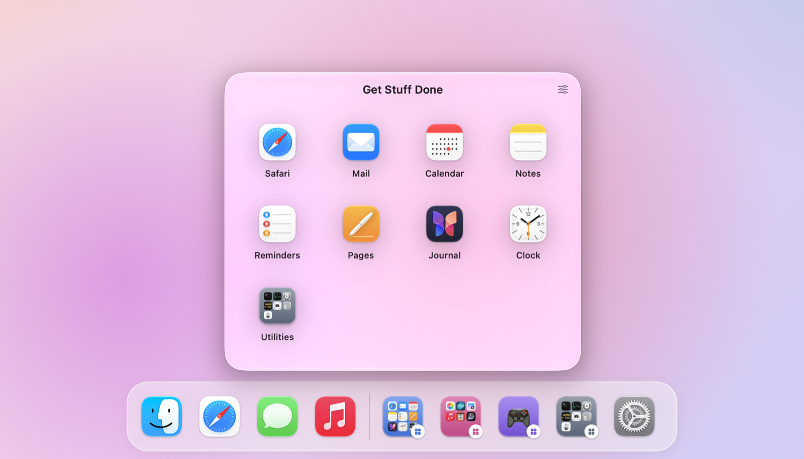
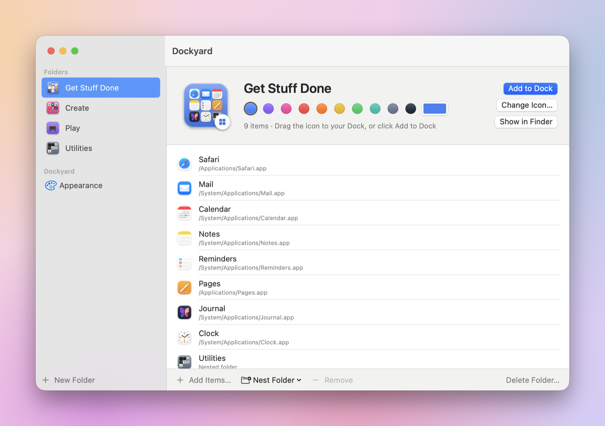
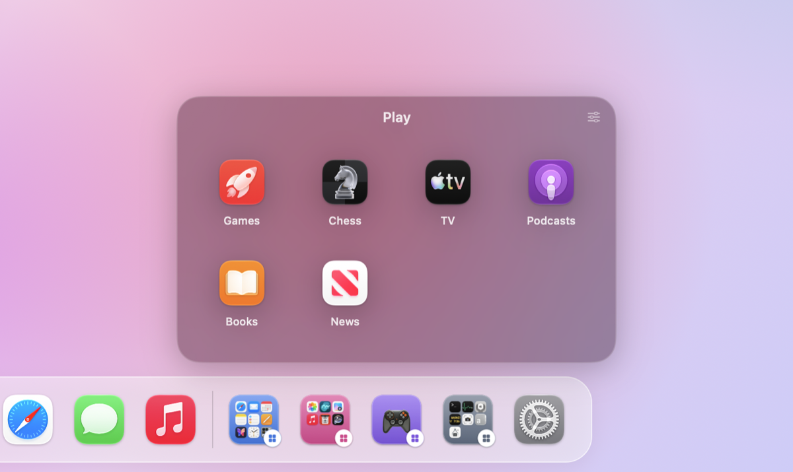

# Dockyard

iOS-style folders for the macOS Dock. Group apps, files, folders and disks into Dock icons that pop open as a grid — free and open source.



<p align="center">
  
  
</p>

## Install

1. Download `Dockyard-<version>.zip` from the [latest release](https://github.com/MaxiG0D/Dockyard/releases/latest) and unzip it.
2. Move **Dockyard.app** to your Applications folder and open it.

Dockyard is signed with a Developer ID and notarized by Apple, so it opens without security warnings.

Requires macOS 14 Sonoma or later. Runs natively on Apple Silicon and Intel.

## Using it

- Dockyard lives in the menu bar. Open **Settings…** to create folders and add apps, files, folders or disks
  (drag them in from Finder, or use **Add Items…**).
- Drag a folder's icon to your Dock, or click **Add to Dock**.
- Click the folder in the Dock to open it. Click again, press Esc, or click elsewhere to close it.
- Drop files onto a folder's Dock icon to add them.
- Click a folder's icon in Settings to change it: its contents, an app from inside it, an SF Symbol, an emoji or an image.
  A small Dockyard badge marks folder icons in the Dock (you can turn it off).
- ⌘-click an item in a popup to reveal it in Finder; ← or Delete goes back from a nested folder.

## Features

- Unlimited folders, nested folders, reorderable items
- Drag & drop from Finder into Settings, into an open popup, or onto a folder's Dock icon
- Popup appearance: Liquid Glass, dark glass, popover, menu or solid background; icon size, columns, rows,
  labels, corner radius, close-after-open
- Custom folder icons and colors, with an optional Dockyard badge
- Notification badges: apps' unread counts on their icons in popups, and a real red badge with the
  total on each folder in the Dock (needs Accessibility access, requested on first use)
- Menu bar menu to open any folder; launch at login

## Build from source

```bash
./build.sh            # builds build/Dockyard.app for this Mac
./build.sh --install  # also copies it to /Applications and launches it
./release.sh          # universal, Developer ID-signed, notarized build, zipped into build/
```

Requires Xcode (or its command line tools) with Swift 5.10+.

## How it works

- **Folders are tiny apps.** Each folder gets a generated bundle in
  `~/Library/Application Support/Dockyard/Folders/<id>/<Name>.app` containing the `DockyardStub` launcher
  and a rendered icon.
- **Clicking it in the Dock** launches the stub, which tells Dockyard to open the folder (a distributed
  notification when Dockyard is running, otherwise a `dockyard://open?id=…` URL that launches it) and quits.
  Dockyard shows a popup panel next to the Dock icon, springing out of it.
- **Dropping files on the Dock icon** opens them "with" the stub, which forwards
  `dockyard://add?id=…&path=…` so they're added to the folder.
- **Dock badges and live icons** come from a Dock tile plugin (`Plugin/DockyardTile.swift`) inside each
  folder bundle. The Dock loads it for the folder's tile even though the folder app isn't running; Dockyard
  reads apps' badges from the Dock's accessibility tree and sends each folder's total (and icon changes) to
  its plugin as distributed notifications.
- **Add to Dock** writes a tile to `com.apple.dock persistent-apps` and restarts the Dock.
  Renaming a folder that's already in the Dock is applied with **Update Dock**, since the Dock stores
  each tile's path and label.

| Path | Purpose |
| --- | --- |
| `Sources/Dockyard/Store.swift` | Folder data, persistence (`folders.json`), stub syncing, Dock actions |
| `Sources/Dockyard/StubManager.swift` | Generates/signs folder bundles; reads and edits Dock prefs |
| `Sources/Dockyard/IconRenderer.swift` | Folder icon drawing, badge, `.icns` output |
| `Sources/Dockyard/Popup.swift` | Popup panel, positioning, grid UI |
| `Sources/Dockyard/SettingsView.swift` | Settings window (folders, items, icon picker, appearance) |
| `Sources/Dockyard/BadgeMonitor.swift` | Reads apps' badges from the Dock; feeds popups and folder tiles |
| `Sources/DockyardStub/main.swift` | The launcher inside every folder bundle |
| `Plugin/DockyardTile.swift` | Dock tile plugin in every folder bundle: badge totals and live icon updates |

## Releasing

Bump `CFBundleShortVersionString` and `CFBundleVersion` in `Resources/Info.plist`, commit, then:

```bash
./release.sh --publish
```

This builds the universal app, signs it with the Developer ID certificate, notarizes and staples it,
tags `v<version>`, pushes, and creates a GitHub release with the zip attached. Notarization needs a
keychain profile, created once with:

```bash
xcrun notarytool store-credentials dockyard --apple-id <your Apple ID> --team-id <your team ID>
```

## License

[MIT](LICENSE)
